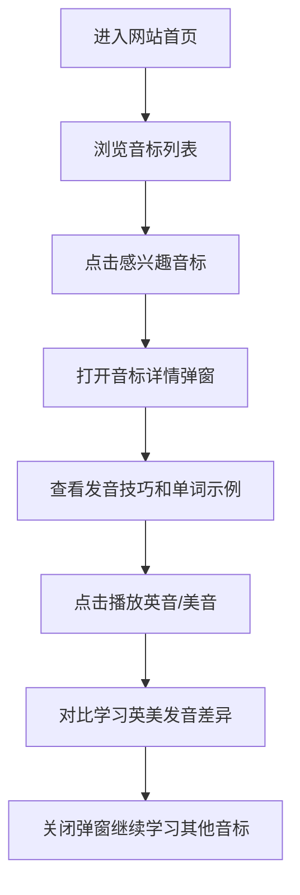
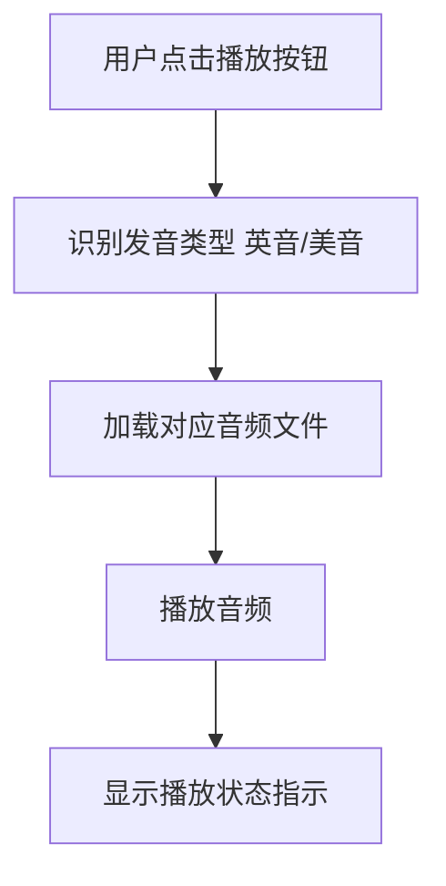

# 英语音标学习教育网站 PRD

## 1. 产品概述

一款专注于英语国际音标(IPA)学习的互动教育网站，帮助学习者掌握48个英语音标的正确发音，提供英音和美音两种发音对比，支持一键发音功能，让学习者能够直观地听辨和模仿标准发音。

- 帮助英语学习者系统学习48个国际音标
- 提供英式发音(British English)和美式发音(American English)的对比学习
- 支持点击即发音的交互功能，提升学习效率
- 适合初学者和希望纠正发音的学习者

## 2. 核心功能

### 2.1 用户角色

| 角色 | 使用方式 | 核心功能 |
|------|---------|----------|
| 学习者 | 直接访问网站 | 浏览音标、学习发音、练习听辨 |

### 2.2 功能模块

1. **首页/音标学习页**: 展示48个国际音标，分元音和辅音两大类
2. **音标详情模块**: 显示单个音标的详细信息，包括发音口型提示、单词示例、英美发音对比
3. **发音播放器**: 点击即可播放英音和美音发音

### 2.3 页面详情

| 页面名称 | 模块名称 | 功能描述 |
|---------|---------|----------|
| 首页 | 音标分类导航 | 将48个音标分为元音和辅音两大类，支持快速切换 |
| 首页 | 元音音标展示区 | 展示20个元音音标，每个音标可点击发音 |
| 首页 | 辅音音标展示区 | 展示28个辅音辅音，每个音标可点击发音 |
| 音标详情弹窗 | 音标大号显示 | 放大显示当前音标符号 |
| 音标详情弹窗 | 发音示例 | 展示3-5个包含该音标的单词示例 |
| 音标详情弹窗 | 英美发音对比 | 提供英式和美式发音的切换和播放 |
| 音标详情弹窗 | 发音技巧 | 显示该音标的口型说明和发音技巧提示 |
| 首页 | 学习进度追踪 | 记录用户学习过的音标数量 |

## 3. 核心流程

### 3.1 音标学习流程

### 3.2 发音播放流程

## 4. 用户界面设计

### 4.1 设计风格

- **主题**: 教育清新风格，融合现代极简主义和学术严谨感
- **配色方案**:
  - 主色调: #2563EB (蓝色 - 信任、学习)
  - 次要色: #10B981 (绿色 - 正确、成功)
  - 强调色: #F59E0B (金色 - 重点标记)
  - 背景色: #F8FAFC (浅灰白)
  - 文字色: #1E293B (深蓝灰)
- **按钮风格**: 圆角卡片式，带有微妙的阴影和悬停动效
- **字体**:
  - 音标符号: 使用专用音标字体如「Noto Sans」或系统音标字符
  - 正文: 思源黑体或系统默认无衬线字体
- **布局风格**: 卡片网格布局，响应式设计，桌面端多列，移动端单列
- **图标风格**: 线性图标，搭配Font Awesome图标库

### 4.2 页面设计概述

| 页面名称 | 模块名称 | UI元素描述 |
|---------|---------|-----------|
| 首页 | 顶部导航栏 | Logo居左，标题居中，整体简洁 |
| 首页 | 分类切换标签 | 元音/辅音切换按钮，当前选中高亮 |
| 首页 | 音标卡片网格 | 3-4列卡片布局，每个卡片显示音标符号 |
| 首页 | 音标卡片 | 大号音标居中，下方标注音标名称 |
| 首页 | 底部学习统计 | 显示已学习音标数量和进度条 |
| 详情弹窗 | 音标大图 | 超大号音标居顶部，带颜色标识 |
| 详情弹窗 | 发音示例列表 | 单词列表，每个单词带英美发音按钮 |
| 详情弹窗 | 发音技巧 | 文字描述发音口型和位置 |
| 详情弹窗 | 关闭按钮 | 右上角X按钮 |

### 4.3 响应式设计

- **桌面端 (≥1024px)**: 4列音标网格，侧边栏学习统计
- **平板端 (768px-1023px)**: 3列音标网格，底部学习统计
- **移动端 (<768px)**: 2列音标网格，全屏弹窗显示详情

### 4.4 动效设计

- 音标卡片悬停: 轻微上浮 + 阴影加深，150ms ease-out
- 弹窗打开: 缩放从0.9到1 + 淡入，200ms ease-out
- 播放按钮: 点击时脉冲动画，表示正在播放
- 页面加载: 音标卡片依次淡入，间隔50ms

## 5. 数据内容

### 5.1 48个国际音标

**元音 (20个)**
- 短元音: /ɪ/, /e/, /æ/, /ʌ/, /ə/, /ɒ/, /ʊ/
- 长元音: /iː/, /ɑː/, /ɔː/, /uː/, /ɜː/
- 双元音: /eɪ/, /aɪ/, /ɔɪ/, /aʊ/, /əʊ/, /ɪə/, /eə/, /ʊə/

**辅音 (28个)**
- 爆破音: /p/, /b/, /t/, /d/, /k/, /g/
- 摩擦音: /f/, /v/, /θ/, /ð/, /s/, /z/, /ʃ/, /ʒ/, /h/, /r/
- 破擦音: /tʃ/, /dʒ/, /tr/, /dr/, /ts/, /dz/
- 鼻音: /m/, /n/, /ŋ/
- 半元音: /w/, /j/
- 边音: /l/

### 5.2 音频资源

- 使用Web Speech API (SpeechSynthesis) 实现发音
- 提供两种语音设置: en-GB (英式) 和 en-US (美式)
- 备选方案: 使用预录音频文件或在线TTS API

## 6. 附加学习内容

- **口型示意图**: 每个音标配有发音口型提示
- **英美发音差异对比**: 常见英美发音差异单词列表
- **学习建议**: 针对不同水平学习者的建议
- **常见错误**: 列出中国学习者常犯的发音错误
