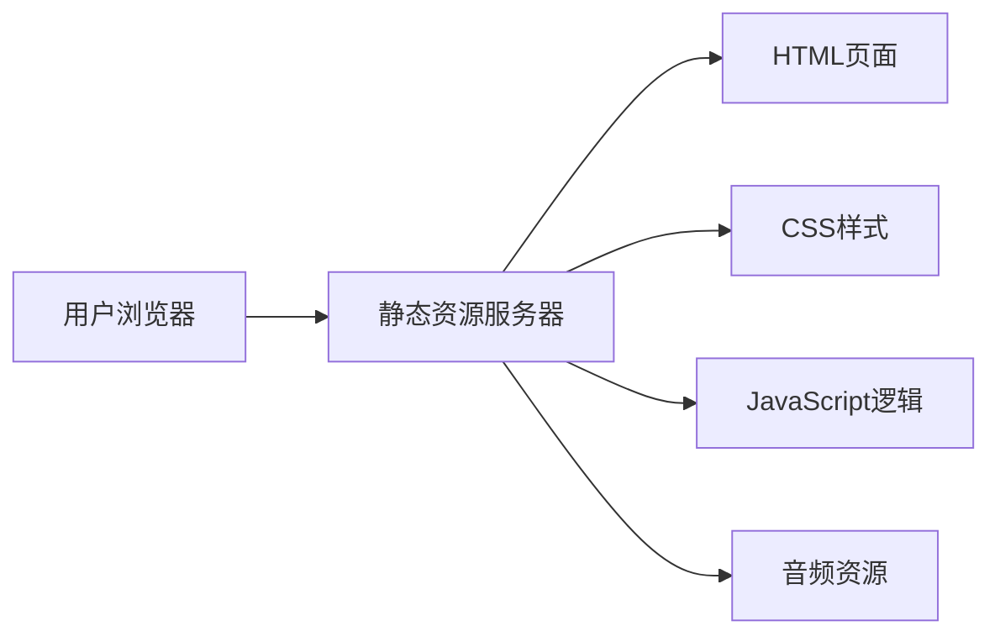

# 英语音标学习网站 - 技术架构文档

## 1. 架构设计



**架构说明**:
- 单页应用 (SPA) 架构
- 纯前端实现，无需后端服务
- 使用Web Speech API实现发音功能
- 所有资源存储在GitHub仓库，支持GitHub Pages部署

## 2. 技术选型

| 技术 | 用途 | 版本 |
|------|------|------|
| HTML5 | 页面结构 | - |
| CSS3 | 样式和动画 | - |
| JavaScript (ES6+) | 交互逻辑 | - |
| Web Speech API | 发音功能 | - |
| LocalStorage | 学习进度存储 | - |
| GitHub Pages | 静态托管 | - |

**不使用**:
- React/Vue等框架 (保持轻量)
- Bootstrap/Tailwind等UI框架 (自定义样式)
- 后端服务 (纯静态)

## 3. 目录结构

```
ipa-learning/
├── index.html          # 主页面
├── css/
│   └── styles.css       # 样式文件
├── js/
│   ├── app.js          # 主应用逻辑
│   ├── phonemes.js     # 音标数据
│   └── speech.js       # 发音功能
├── assets/
│   └── sounds/         # 备用音频资源
├── README.md           # 项目说明
└── .nojekyll           # GitHub Pages配置
```

## 4. 文件结构说明

### 4.1 index.html
- 语义化HTML5结构
- SEO友好的meta标签
- 响应式viewport配置

### 4.2 css/styles.css
- CSS变量定义主题色
- 响应式媒体查询
- 动画关键帧定义
- BEM命名规范

### 4.3 js/phonemes.js
- 48个音标数据结构
- 音标分类信息
- 示例单词列表
- 发音技巧说明

### 4.4 js/speech.js
- Web Speech API封装
- 英音/美音切换
- 播放状态管理

### 4.5 js/app.js
- DOM操作
- 事件绑定
- LocalStorage进度管理
- 弹窗控制逻辑

## 5. 核心功能实现

### 5.1 音标展示
```javascript
// 音标数据结构示例
const phoneme = {
  symbol: '/æ/',
  name: 'American Æ',
  category: 'vowel',
  type: 'short',
  british: {
    word: 'cat',
    pronunciation: 'kæt',
    audio: null
  },
  american: {
    word: 'cat',
    pronunciation: 'kæt',
    audio: null
  },
  tips: '嘴巴张大，舌尖抵下齿'
}
```

### 5.2 发音实现
```javascript
// Web Speech API使用
function speak(text, accent) {
  const utterance = new SpeechSynthesisUtterance(text);
  utterance.lang = accent === 'british' ? 'en-GB' : 'en-US';
  utterance.rate = 0.8;
  speechSynthesis.speak(utterance);
}
```

### 5.3 进度存储
```javascript
// LocalStorage结构
{
  "ipa-progress": {
    "learned": ["/æ/", "/i:/", ...],
    "lastVisit": "2024-01-01"
  }
}
```

## 6. 浏览器兼容性

| 浏览器 | 最低版本 | 特性支持 |
|--------|---------|----------|
| Chrome | 80+ | 完整支持 |
| Firefox | 75+ | 完整支持 |
| Safari | 14+ | 完整支持 |
| Edge | 80+ | 完整支持 |

**注意**: Web Speech API在部分移动浏览器可能不支持。

## 7. 性能指标

- 首次加载: < 500KB
- 首屏渲染: < 1s
- 交互响应: < 100ms
- Lighthouse评分: > 90

## 8. 部署流程

1. 将代码推送到GitHub仓库
2. 在仓库设置中启用GitHub Pages
3. 选择main分支作为源
4. 等待部署完成 (通常1-2分钟)
5. 访问 `https://[username].github.io/[repo-name]/`

## 9. 数据模型

### 9.1 音标数据模型

```javascript
// 完整数据结构
{
  id: "vowel-01",
  symbol: "/iː/",
  name: "长元音 /iː/",
  category: "vowel",
  subcategory: "long",
  examples: [
    {
      word: "see",
      ipa: "/siː/",
      audioBritish: null,
      audioAmerican: null
    }
  ],
  tips: "微笑口型，类似于汉字'衣'的延长音"
}
```

### 9.2 进度数据模型

```javascript
// LocalStorage存储
{
  version: 1,
  learnedPhonemes: ["vowel-01", "consonant-01"],
  lastUpdated: "2024-01-01T12:00:00Z"
}
```

## 10. 可访问性

- 支持键盘导航
- 适当的ARIA标签
- 颜色对比度符合WCAG AA标准
- 支持屏幕阅读器
